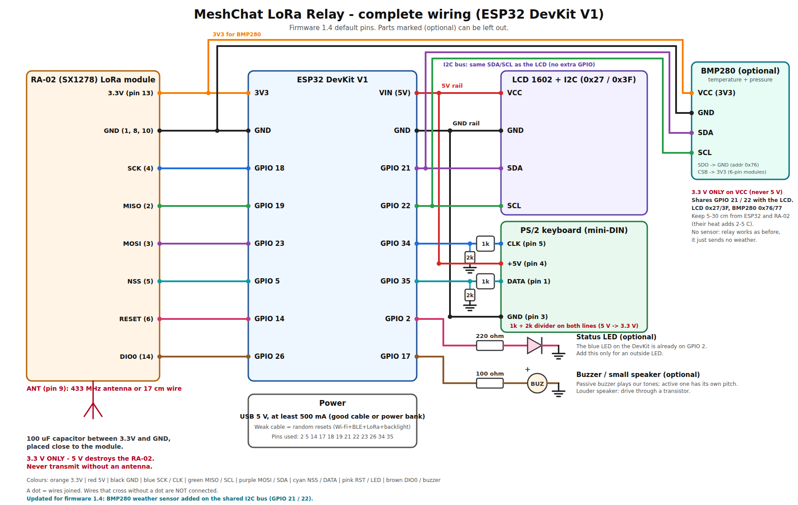

# ওয়্যারিং / Wiring (ESP32 DevKit V1)



> অ্যাপে LoRa ও LoRa-ডিভাইস কেমন দেখায়: [`app_screens/`](app_screens/) ফোল্ডারের ছবিগুলো দেখুন।

> ⚠️ সংযোগ দেওয়ার আগে USB খুলে রাখুন। **RA-02 শুধু 3.3 V**, 5 V দিলে নষ্ট হবে। **অ্যান্টেনা না লাগিয়ে কখনো ট্রান্সমিট করাবেন না** (মডিউল পুড়ে যেতে পারে)।

## ১. LoRa RA-02 (SX1278, 433 MHz) → ESP32

| RA-02 পিন | ESP32 পিন | মন্তব্য |
|---|---|---|
| 13 · 3.3V | **3V3** | সঙ্গে 100 µF ক্যাপাসিটর (3V3–GND) মডিউলের কাছে দিন, ট্রান্সমিটের সময় ~120 mA টানে |
| 1, 8, 10 · GND | **GND** | সব GND |
| 4 · SCK | GPIO **18** | |
| 2 · MISO | GPIO **19** | |
| 3 · MOSI | GPIO **23** | |
| 5 · NSS | GPIO **5** | |
| 6 · RESET | GPIO **14** | |
| 14 · DIO0 | GPIO **26** | "প্যাকেট এসেছে" সিগন্যাল |
| 9 · ANT | অ্যান্টেনা | 433 MHz স্প্রিং/স্টিক অ্যান্টেনা, বা ~17 cm সোজা তার (¼ তরঙ্গ) |

RA-02-র পিন 2 mm দূরত্বের, তাই breadboard-এ বসাতে একটি RA-02 ব্রেকআউট/অ্যাডাপ্টার বোর্ড লাগবে। DIO1–DIO5 লাগবে না।

## ২. LCD 1602

**I2C ব্যাকপ্যাক থাকলে (৪ তার — সহজ, ডিফল্ট):**

| LCD | ESP32 |
|---|---|
| GND | GND |
| VCC | **VIN** (5 V) |
| SDA | GPIO **21** |
| SCL | GPIO **22** |

ঠিকানা সাধারণত `0x27` বা `0x3F` (Setup পেজে বদলানো যায়)। কিছু ব্যাকপ্যাকের pull-up 5 V-এ থাকে; সাধারণত এতে কাজ করে, নিশ্চিন্ত থাকতে I2C লেভেল-শিফটার ব্যবহার করুন।
আলো ঠিক থাকলেও লেখা না দেখা গেলে ব্যাকপ্যাকের নীল ট্রিমারটি ঘুরিয়ে কনট্রাস্ট ঠিক করুন।

**ব্যাকপ্যাক না থাকলে (১৬ পিন, সরাসরি):** `platformio.ini`-তে `-DLCD_I2C=0` করুন।

| LCD পিন | সংযোগ |
|---|---|
| 1 VSS, 5 RW, 16 K | GND |
| 2 VDD, 15 A | 5 V (VIN) (A-তে 220 Ω রোধ দিয়ে) |
| 3 V0 | 10 kΩ ট্রিমারের মাঝের পা (কনট্রাস্ট), ট্রিমারের দুই প্রান্ত 5 V ও GND |
| 4 RS | GPIO **13** |
| 6 E | GPIO **27** |
| 11 D4 | GPIO **32** |
| 12 D5 | GPIO **33** |
| 13 D6 | GPIO **25** |
| 14 D7 | GPIO **4** |

## ৩. কিবোর্ড

### ❗ USB কিবোর্ড সম্পর্কে গুরুত্বপূর্ণ কথা
**ESP32 DevKit V1-এ USB host নেই।** ওর USB পোর্ট শুধু কম্পিউটারের সাথে প্রোগ্রামিং/সিরিয়ালের জন্য, তাই সরাসরি USB কিবোর্ড লাগানো যায় না। তিনটি উপায়:

1. **PS/2 কিবোর্ড** (এই ফার্মওয়্যারে তৈরি, সবচেয়ে সহজ) — নিচের নকশা অনুযায়ী ২টি পিনে লাগান। অনেক USB কিবোর্ড একটি সস্তা "USB→PS/2 প্যাসিভ অ্যাডাপ্টার" দিয়ে চলে, তবে শুধু সেই কিবোর্ড যেগুলো PS/2 মোড সাপোর্ট করে (সব করে না)।
2. **USB Host Shield (MAX3421E)** বা **ESP32-S3** বোর্ড (এতে USB host আছে) — তখন `src/keyboard.cpp`-তে USB HID লাইব্রেরি (যেমন EspUsbHost) যোগ করতে হবে। বাকি কোড বদলাতে হবে না: শুধু `Keyboard::next()` থেকে `KeyEvent` ফেরত দিলেই হবে।
3. **কম্পিউটার বা ফোনের টার্মিনাল** — USB তারে বোর্ড জুড়ে সিরিয়াল মনিটরে (115200) টাইপ করলেও কিবোর্ডের মতোই কাজ করে (বাংলা টাইপও চলে, LCD-তে `?` দেখাবে)।

### PS/2 সংযোগ (৬-পিন mini-DIN সকেট)

| PS/2 পিন | সংযোগ |
|---|---|
| 1 DATA | 1 kΩ রোধ → GPIO **35**; GPIO 35 → 2 kΩ রোধ → GND |
| 5 CLK | 1 kΩ রোধ → GPIO **34**; GPIO 34 → 2 kΩ রোধ → GND |
| 4 +5V | **VIN** (5 V) |
| 3 GND | GND |

কিবোর্ডের লাইন 5 V-এ চলে, তাই 1 kΩ + 2 kΩ ভোল্টেজ ডিভাইডার (≈3.3 V) লাগবেই — সরাসরি লাগালে ESP32 নষ্ট হতে পারে।

### কীগুলো
| কী | কাজ |
|---|---|
| অক্ষর/সংখ্যা | টাইপ |
| **Enter** | পাঠান |
| **Tab** | কাকে পাঠাবেন: Public board → একজন একজন করে পরিচিত মানুষ |
| Backspace / Esc | মোছা / পুরো লেখা বাতিল |
| ↑ / ↓ | পুরোনো মেসেজ দেখা |
| F1 | স্ট্যাটাস পেজ বদল (Node ID, Wi-Fi) |

LCD ASCII ছাড়া অক্ষর দেখাতে পারে না (বাংলা `?`)। বাংলা চ্যাটের জন্য ওয়েব পেজ বা ফোন ব্যবহার করুন।

## ৪. বিদ্যুৎ
USB 5 V (কমপক্ষে 500 mA, ভালো তার/চার্জার)। Wi-Fi + BLE + LoRa + ব্যাকলাইট একসাথে চললে খারাপ তারে রিসেট হতে পারে। পাওয়ারব্যাংক থেকেও চলবে।

## ৫. নকশা (ফার্মওয়্যার 1.5)

উপরের ছবিটাই পূর্ণ নকশা (`wiring_diagram.png` / `.svg`)। পিন-সারাংশ:

```
RA-02 (SX1278)      ESP32 DevKit V1                 অন্যান্য
 3.3V  ───────────── 3V3  ─┬─────────────────────── BMP280 VCC (ঐচ্ছিক)
 GND   ───────────── GND  ─┼─────────────────────── BMP280 GND, LCD GND, PS/2 GND
 SCK   ───────────── 18    │ 21 (SDA) ───────────── LCD SDA + BMP280 SDA (একই দুই তার)
 MISO  ───────────── 19    │ 22 (SCL) ───────────── LCD SCL + BMP280 SCL
 MOSI  ───────────── 23    │ VIN 5V ─────────────── LCD VCC, PS/2 +5V
 NSS   ───────────── 5     │ 34 ◄── 1k/2k ডিভাইডার ◄ PS/2 CLK
 RST   ───────────── 14    │ 35 ◄── 1k/2k ডিভাইডার ◄ PS/2 DATA
 DIO0  ───────────── 26    │ 2  ───────────────────── LED (ঐচ্ছিক)
 ANT   ── অ্যান্টেনা        │ 17 ───────────────────── বাজার (ঐচ্ছিক)
```

ব্যবহৃত GPIO: 2, 5, 14, 17, 18, 19, 21, 22, 23, 26, 34, 35।

## ৬. ইন্ডিকেটর LED ও ছোট স্পিকার/বাজার (ঐচ্ছিক)

| অংশ | ESP32 | মন্তব্য |
|---|---|---|
| LED | GPIO **2** | ডেভকিটের নীল LED এই পিনেই আছে, কিছু জুড়তে হবে না। বাইরের LED চাইলে GPIO 2 → 220 Ω রোধ → LED (+) → LED (−) → GND |
| বাজার/স্পিকার | GPIO **17** | প্যাসিভ বাজার সরাসরি GPIO 17 ও GND-এ। ছোট স্পিকার হলে GPIO 17 → 100 Ω রোধ → স্পিকার → GND (জোরালো শব্দের জন্য ট্রানজিস্টর দিন, GPIO থেকে ~12 mA-র বেশি টানবেন না) |

- অ্যাক্টিভ বাজারেও কাজ করে, তবে নিজের নির্দিষ্ট সুরে বাজবে, আমাদের টোন নয়।
- পিন বদলাতে Setup পেজের "আলো ও শব্দ" অংশ দেখুন। অনুমোদিত পিন: 2, 15, 16, 17 (I2C LCD হলে 4, 13, 25, 27, 32, 33-ও)। ফাঁকা রাখলে ঐ অংশ বন্ধ।
- কখন কী হয়: নতুন ব্যক্তিগত মেসেজ = দুটো বিপ + LED জ্বলে থাকে (কীবোর্ডে যেকোনো বোতাম চাপলে নেভে); পাবলিক পোস্ট = ছোট একটা বিপ (৩ সেকেন্ডে একবারের বেশি নয়); SOS = দ্রুত বিপ-বিপ-বিপ, ৫ সেকেন্ড পরপর, যতক্ষণ SOS চালু বা কোনো বোতাম না চাপা হয়; ফোন যুক্ত হলে ছোট বিপ; চালু হলে দুই-সুরের টোন; LoRa-তে পাঠানো/পাওয়ায় LED-র ক্ষণিক ঝলক (শব্দ নেই)।
- "শব্দ চালু" বন্ধ করলে শুধু LED কাজ করে (রাতের জন্য)।

## ৭. BMP280 আবহাওয়া সেন্সর (ঐচ্ছিক) — তাপমাত্রা ও বায়ুচাপ

LCD-র **একই দুই তার (SDA/SCL)**-এ সমান্তরালে লাগে, আলাদা পিন লাগে না (ঠিকানা আলাদা: LCD 0x27/0x3F, BMP280 0x76/0x77)।

| BMP280 মডিউল | ESP32 |
|---|---|
| VCC (VIN) | **3V3** (⚠️ শুধু 3.3 V; "3–5 V" লেখা রেগুলেটরওয়ালা মডিউল না হলে 5 V দেবেন না) |
| GND | GND |
| SDA | GPIO **21** (LCD-র SDA-র সাথে একসাথে) |
| SCL | GPIO **22** (LCD-র SCL-র সাথে একসাথে) |
| SDO | GND → ঠিকানা `0x76` (3V3 দিলে `0x77`) |
| CSB | 3V3 (I2C মোড; অনেক মডিউলে আগে থেকেই বাঁধা, ৪-পিন মডিউলে লাগে না) |

- ফার্মওয়্যার নিজে `0x76`/`0x77` খুঁজে নেয় (Setup পেজে নির্দিষ্টও করা যায়)। সিরিয়ালে বুটের সময় `weather: BMP280 found at 0x76` দেখাবে।
- সস্তা "BMP280" নামে বিক্রি হওয়া অনেক বোর্ড আসলে BME280; ওতেও তাপমাত্রা ও চাপ ঠিকঠাক চলে (আর্দ্রতা ব্যবহার হয় না)।
- সেন্সর ESP32/LoRa মডিউল থেকে একটু দূরে রাখুন: বোর্ডের গরমে তাপমাত্রা ২–৫ °C বেশি দেখাতে পারে। তারে লম্বা করলে ৩০ cm-এর মধ্যে রাখুন।
- সেন্সর না থাকলে নোড আগের মতোই চলে, শুধু আবহাওয়া পাঠায় না (প্রতি মিনিটে নতুন করে খোঁজে, তাই পরে লাগালে নিজে চালু হবে)।
